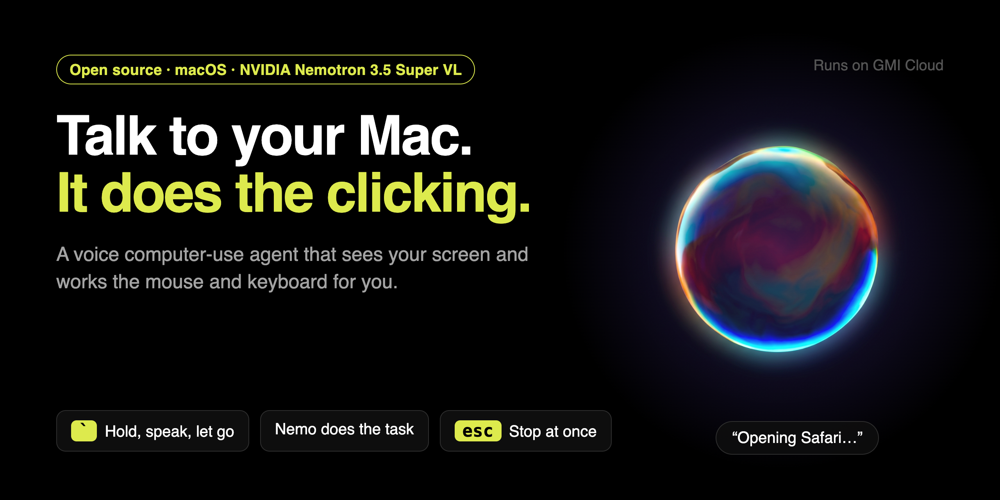
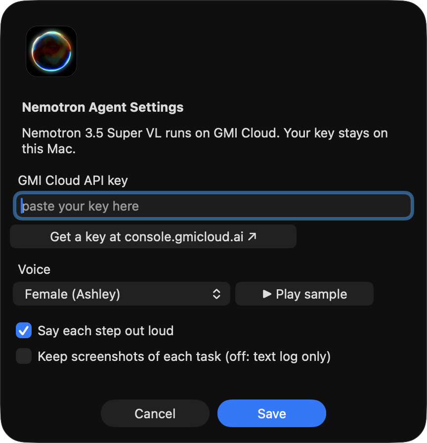
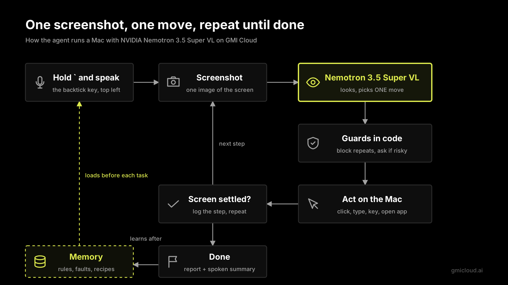

# Nemotron Agent: an open-source voice computer-use agent for macOS



**Hold the `` ` `` key, say a task, let go. The agent looks at your screen and uses the mouse and keyboard until the task is done.**

Nemotron Agent is a free, open-source **AI computer-use agent for Mac**. It runs **NVIDIA Nemotron 3.5 Super VL** (a vision-language model) on **GMI Cloud**. You control it with your voice, from the menu bar. Speech-to-text runs on your Mac.

- 🎙️ **Voice control for macOS.** Push to talk with `` ` ``. Whisper turns your words into text on your Mac.
- 🖱️ **Real computer use.** It clicks, types, presses shortcuts, scrolls and opens apps. It works in any app, not only the browser.
- 🔊 **Talks back.** A female or a male voice says each step. You pick in Settings.
- 🛑 **Safe by default.** Esc stops it at once. It asks before it sends, deletes, buys or posts. It never types passwords.
- 🧠 **Learns from mistakes.** A small local memory keeps rules, faults and short recipes. The next run is faster.
- 🔒 **Private.** No screenshots are kept by default. Your key and your data stay on your Mac.

[Website](https://roangws.github.io/nemotron-3.5-super-computer-use-app/) · [Quick start](#quick-start) · [Settings](#settings) · [How it works](#how-it-works) · [FAQ](#faq)

---

## What you need

| | |
|---|---|
| Mac | Apple Silicon (M1 or newer), macOS 13 or newer |
| Python | 3.11 or newer (`brew install python@3.12`) |
| GMI Cloud API key | Get one at **[console.gmicloud.ai/user-console/ie](https://console.gmicloud.ai/user-console/ie)** |
| Disk | About 2 GB (the speech model is 1.6 GB) |

## Quick start

**1. Get the code and install it.** This makes a Python environment, installs the packages, downloads the speech model and puts **Nemotron Agent** in your Applications folder.

```sh
git clone https://github.com/roangws/nemotron-3.5-super-computer-use-app.git
cd nemotron-3.5-super-computer-use-app
./install.sh
```

No admin rights? Use `./install.sh ~/Applications`.

**2. Open the app.** Open **Nemotron Agent** from Applications or Spotlight. The orb shows in the menu bar. There is no Dock icon.

> macOS 26: if you do not see the orb, go to System Settings → Menu Bar and turn on **Nemotron Agent**.

**3. Add your API key.** The Settings window opens on the first start.
1. Click **Get a key at console.gmicloud.ai**.
2. Make a key and copy it.
3. Paste it in the **GMI Cloud API key** field.
4. Click **Save**. Nemo says hello.

**4. Allow the permissions.** Go to System Settings → Privacy & Security. Turn on **Nemotron Agent** in each of these:

| Permission | Why |
|---|---|
| Screen Recording | To see the screen |
| Accessibility | To click and type |
| Input Monitoring | To hear the `` ` `` key |
| Microphone | To hear your voice |

Then quit the app from its menu and open it again.

**5. Try it.** Hold `` ` ``, say *"Open Calculator and compute 19 times 37"*, let go.

### Good first tasks

- "Open Safari and go to apple.com"
- "Open the Downloads folder in Finder"
- "Open System Settings and go to the Sound page"
- "In Safari, search Wikipedia for the Golden Gate Bridge"
- "Make a new folder on the Desktop called Projects"
- "Remember that my browser is Google Chrome" (saves to memory, runs nothing)

## Settings

Menu bar orb → **Settings…** (or press `⌘,` while the menu is open).



| Setting | What it does | Default |
|---|---|---|
| GMI Cloud API key | Your key for Nemotron and the voice. It is saved only on your Mac (file mode 600). | empty |
| Voice | **Female (Ashley)** or **Male (Dennis)**. Click **▶ Play sample** to hear it. | Female |
| Say each step out loud | Nemo says each step, like "Opening Safari". | on |
| Keep screenshots of each task | On: each task folder keeps the screenshots and your voice clip. Off: only the text log. | off |

You can also use the command line:

```sh
.venv/bin/python src/settings.py                    # show the settings
.venv/bin/python src/settings.py --key YOUR_KEY     # save the API key
.venv/bin/python src/settings.py --voice male       # female | male
.venv/bin/python src/settings.py --screenshots on   # on | off
```

A `GMI_API_KEY` environment variable, or a `.env` file in this folder, wins over the saved key. See `.env.example`.

Advanced settings (max steps, risky words, the talk key and more) are in [`config.toml`](config.toml).

## How to use it

| Do this | What happens |
|---|---|
| Hold `` ` ``, speak, let go | It turns your words into text and runs the task. The `` ` `` key does not type. |
| Menu → **Type a task…** | Type a task instead of speaking it. |
| Press **Esc** | Stops the task at once. |
| Push the mouse into a screen corner | Emergency stop. |
| Menu → **Agent On** | Turn it off and `` ` `` types as normal again. |
| Menu → **Dry run** | Plans the steps but does not click or type. |
| Menu → **Open last report** | Shows each step and why it did it. |

**The orb.** While Nemo listens, works or talks, a glowing orb shows above the Dock. It pulses with your voice and with Nemo's voice. A caption says what it is doing. The model never sees the orb.

**Safety.**
- It asks before any action with words like send, delete, buy, pay, submit or post. Click **Allow** or **Stop**, or hold `` ` `` and say "yes" or "no".
- It never types passwords. It asks you instead.
- It never types into your terminal or code editor unless the task names it.
- It stops after 25 steps.

## How it works



1. You speak. **Whisper large-v3-turbo** (MLX) turns it into text on your Mac.
2. The agent takes one screenshot and sends it with the task to **Nemotron 3.5 Super VL** on GMI Cloud.
3. The model picks **one** action: click, type, key, scroll, open app, done, or ask you.
4. Code guards check it: no repeats that failed, no keys into the wrong app, a prompt for risky actions.
5. Before a click, it looks again at a zoomed crop to aim better.
6. It acts, waits until the screen stops changing, and repeats.
7. When the task is done, it saves short lessons to memory.

Each step takes about 3.4 s. On a 10-task test suite with real checks (not the model's own "done"), it passes **10/10** with memory on.

## Your data

Everything lives on your Mac, outside the code folder:

```
~/Library/Application Support/Nemotron Agent/
  settings.json   your API key and choices
  memory/         rules.md (edit by hand), facts, faults, recipes
  sessions/       one folder per task: report.html, steps, model replies
~/Library/Logs/NemotronAgent.log   errors and crashes
```

- Screenshots go to GMI Cloud only to choose the next action.
- Screenshots are **not saved** unless you turn on **Keep screenshots**.
- Set `NEMO_HOME` to use another folder.

## Command line

```sh
.venv/bin/python src/agent.py "open Calculator and compute 19 times 37"
.venv/bin/python src/agent.py --dry-run "open Safari"
.venv/bin/python src/memory.py --show                 # what it remembers
.venv/bin/python src/memory.py --remember "my browser is Chrome"
.venv/bin/python src/agent.py --eval --suite suite10  # 10 tasks with real checks
.venv/bin/python -m pytest tests -q                   # fast tests, no screen or network
./start.command                                       # run the menu bar app without building it
```

The terminal must have the same permissions as the app.

## Project layout

```
src/
  app.py        menu bar app, Settings window, push-to-talk, the orb
  agent.py      the loop: screenshot → model → guards → action
  model.py      GMI Cloud client for Nemotron 3.5 Super VL
  actions.py    mouse and keyboard actions, app names, safety guards
  screen.py     screenshots, change detection, step pictures
  memory.py     rules, faults, facts and recipes
  tts.py        voice (Inworld TTS on GMI Cloud)
  voice.py      microphone and local speech-to-text
  settings.py   API key, voice and switches
  paths.py      where your data lives
config.toml     advanced settings
memory/rules.md starting rules (copied to your data folder on first run)
evals/          test tasks with real checks
tests/          unit tests
install.sh      one-step setup
```

## FAQ

**Is it free?** The code is free and open source (MIT). The model and the voice run on GMI Cloud and use your GMI account. See [gmicloud.ai](https://www.gmicloud.ai) for prices.

**Does it work on Intel Macs, Windows or Linux?** Not now. It needs Apple Silicon for local speech-to-text and macOS for the menu bar, screen capture and input.

**How is it different from Claude computer use or OpenAI Operator?** It is a small open-source agent you run on your own Mac. It uses an open-weight model, NVIDIA Nemotron 3.5 Super VL, and works in any app, not only in a browser.

**Can I change the talk key?** Yes. Set `talk_keycode` in `config.toml` (50 is `` ` ``).

**It does not hear the `` ` `` key.** Turn on Accessibility and Input Monitoring for Nemotron Agent, then quit and open the app again.

**It says "No GMI API key".** Open Settings and paste your key from [console.gmicloud.ai/user-console/ie](https://console.gmicloud.ai/user-console/ie).

**Something broke.** Menu → **Open log**, or read `~/Library/Logs/NemotronAgent.log`. Please open an issue with the error.

## Contributing

Issues and pull requests are welcome. Run `.venv/bin/python -m pytest tests -q` before you send a change.

## License

[MIT](LICENSE)

---

<sub>Keywords: computer use agent, AI agent for Mac, macOS automation, voice control Mac, voice assistant, desktop agent, GUI agent, screen agent, vision language model, NVIDIA Nemotron, Nemotron 3.5 Super VL, GMI Cloud, open source Operator alternative, push to talk, Whisper, MLX, Apple Silicon.</sub>
